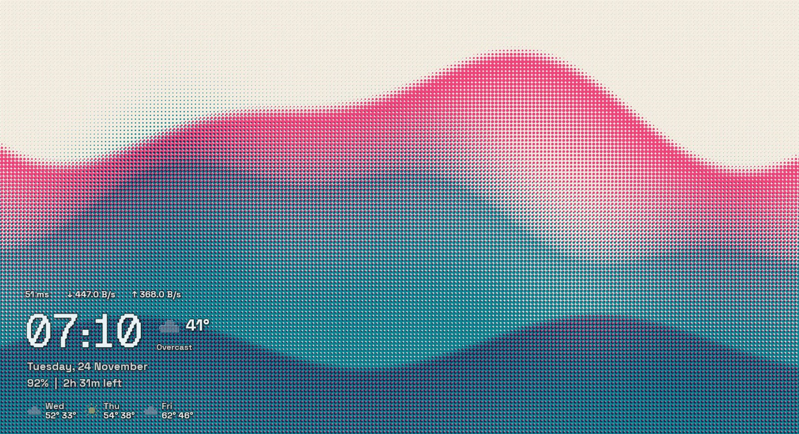
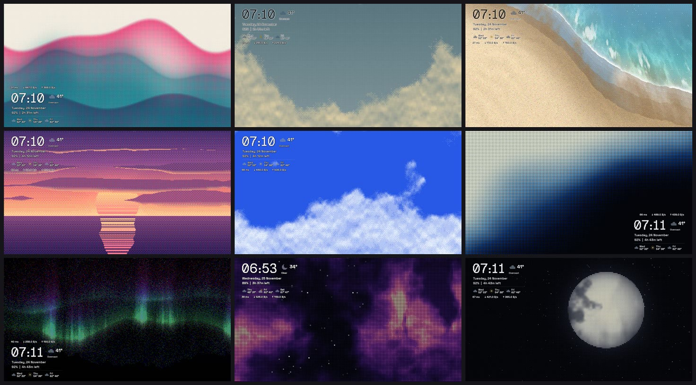
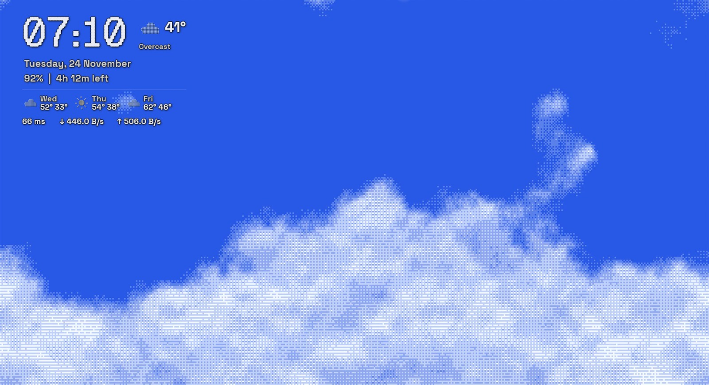
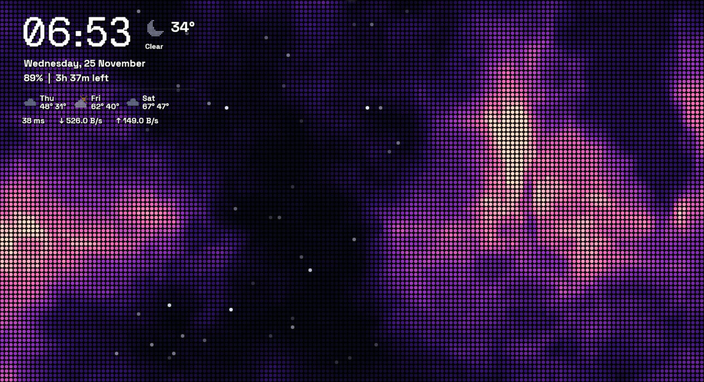
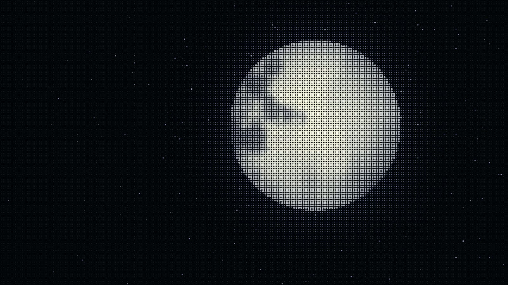

# Loopscape

**Loopscape** is a live wallpaper for Windows 10 and 11. It plays looping animated landscapes (shores, pixel clouds, auroras, nebulas and more) behind your desktop icons, with dark styles at night. It comes with **LaptopInfo**, a Rainmeter skin with clock, battery, weather, Wi‑Fi and network widgets.



## Screenshots

Each style is a looping video; the widgets snap to a spot that suits it.


*The shore loop (40 s, shown here at 5× speed).*



| | | |
|---|---|---|
|  **pixelclouds** |  **shore** |  **sunset** |
|  **bluesky** |  **halftone** |  **aurora** |
|  **nebula** |  **moon** |  **riso** |

Dark styles (aurora, nebula, moon, …) rotate in at night.

## Install

Works on Windows 10 and 11 (64-bit).

1. Download `Loopscape-Setup-<version>.exe` from [Releases](https://github.com/choco-mazapan/loopscape/releases).
2. Run it. It installs for your user only, so there's no administrator prompt (except Rainmeter's own installer, if you tick it).
3. Type your city for the weather, and leave **Install Rainmeter** ticked if you don't have it. Rainmeter is the free, open-source program that draws the widgets.

The installer isn't code-signed yet, so Windows SmartScreen may say "Windows protected your PC". Click **More info → Run anyway**. `SHA256SUMS.txt` on the release page has the installer's checksum, and the [release workflow](.github/workflows/release.yml) log shows it was built from the tagged source.

Four styles come with the installer (riso, shore, pixel clouds, aurora). On the **Wallpaper styles** page, choose whether to download the other 15 after setup (about 250 MB): all of them, none, or the ones you tick. They download in the background, about 2–50 MB each depending on the video format. Any you skip download the first time you pick them, or all at once from the tray icon's menu.

## Usage

- **Pick a style:** click the tray icon for the widgets' Settings panel, or right-click it for the style menu.
- **Rotate styles:** choose *Rotate day/night* in the Settings panel. It changes style every hour by default (*Change every* in the Rotation section), with dark styles at night.
- **Skip to the next style:** Win+Alt+N.
- **Start with Windows:** a checkbox in the tray menu (also in Task Manager → Startup apps).
- **Video format:** the tray menu's *Video format*. *Automatic* picks the smallest format your graphics chip plays (AV1, then HEVC, then H.264), so the CPU stays idle. On a desktop where battery doesn't matter you can pick AV1 for smaller files even if the CPU has to decode it. Changing it downloads your styles again in that format. Styles that don't look as good in a format are only published in H.264.
- **Weather location:** Settings panel → Widgets → City.
- **Advanced settings:** `%USERPROFILE%\Loopscape\Loopscape.ini` (commented; changes apply by themselves).

## What it changes on your PC

| What | Where | Removed by uninstall |
|---|---|---|
| The program (Loopscape, mpv video player, list of downloadable styles) | `%LOCALAPPDATA%\Programs\Loopscape` | yes |
| Videos, stills, Loopscape.ini, log | `%USERPROFILE%\Loopscape` | if you choose to |
| The widgets | `Documents\Rainmeter\Skins\LaptopInfo` | yes (your settings only if you choose to) |
| Start with Windows | `HKCU\Software\Microsoft\Windows\CurrentVersion\Run` → `Loopscape` | yes |
| Apps list entry | Settings → Apps → Installed apps | yes |
| Rainmeter (optional) | installed by its official installer | no: uninstall it separately |

It needs no administrator rights, runs no scripts, and doesn't change your Windows wallpaper settings. It connects to:

- [Open-Meteo](https://open-meteo.com/) for the weather and to look up your city (no account, no API key).
- [BigDataCloud](https://www.bigdatacloud.com/), only if you choose *Windows location*, to name the place.
- GitHub, to download styles you pick.

There's no IP-address location lookup, telemetry or update check.

To uninstall, use Settings → Apps → Loopscape → Uninstall. It asks whether to also delete your videos and settings.

## Building from source

Developer setup. Users don't need any of this.

- `wallpaper/` holds the Loopscape launcher (`Loopscape.cs`) and the video and still renderers (`make-loop.ps1`, `styles/`).
- `rainmeter/LaptopInfo/` is the Rainmeter skin (Clock, WiFi, Settings, ViewMenu, SnapGuides).
- `rainmeter/WeatherFetch.cs` and `rainmeter/WifiInfo.cs` are the helpers the skin calls.
- `build/build.ps1` compiles everything with the C# compiler built into Windows (.NET Framework 4.x).
- `build/stage.ps1` and `installer/Loopscape.iss` ([Inno Setup](https://jrsoftware.org/isinfo.php)) build the installer.
- `sync.ps1` pushes your working copy to the running setup: it rebuilds what changed, copies the skin and restarts Loopscape.

Rendering the videos needs [FFmpeg](https://ffmpeg.org/) with libx265, libsvtav1 and libvmaf (`winget install Gyan.FFmpeg`, the full build). The loop goes to `%USERPROFILE%\Loopscape`; each style is rendered once and encoded as H.264, HEVC and AV1 into `build\videos`:

```powershell
.\wallpaper\make-loop.ps1
.\wallpaper\styles\build-styles.ps1
```

HEVC and AV1 files are kept only if they're at least 15% smaller than H.264 and score within 1 VMAF point of it against a lossless render (`-MinSaving`, `-MaxVmafLoss`; results in `build\videos\quality.txt`). A full render takes about 2 hours of CPU. `build-styles.ps1 -Styles riso,shore` renders only some styles, and `-Preview` renders one still per style. `wallpaper\styles\make-stills.ps1` renders PNG stills for use as a normal Windows background.

To make a release:

1. Run `build\make-styles-release.ps1`.
2. Upload `build\styles-release` to the `styles-v1` release.
3. Commit `installer\styles.json` and `installer\styles-SHA256SUMS.txt`.
4. Push a `v*` tag. The [release workflow](.github/workflows/release.yml) builds the installer and makes a draft release.

Fonts: Space Grotesk and Geist Pixel, bundled under their own licenses (see `rainmeter/LaptopInfo/@Resources/Fonts`).

## License

[MIT](LICENSE). The bundled fonts keep their own licenses.
