# Loopscape

Loopscape is a live wallpaper for Windows 10 and 11. It plays looping animated landscapes (shores, pixel clouds, auroras, nebulas and more) behind your desktop icons and switches to dark styles at night. It comes with a set of desktop widgets, drawn by [Rainmeter](https://www.rainmeter.net/), that show the time, weather, battery, network and more, and also move to a quiet spot on each wallpaper.

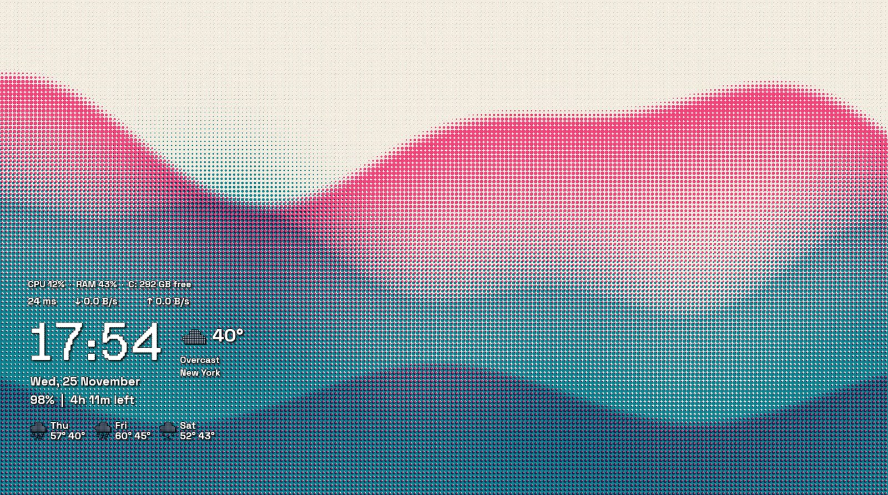

- [Install](#install)
- [Wallpaper styles](#wallpaper-styles)
- [Widgets](#widgets)
- [Using Loopscape](#using-loopscape)
- [Make your own style with Claude](#make-your-own-style-with-claude)
- [Privacy and what it changes on your PC](#privacy-and-what-it-changes-on-your-pc)
- [Building from source](#building-from-source)

## Install

Loopscape works on 64-bit Windows 10 and 11.

1. Download `Loopscape-Setup-<version>.exe` from the [newest release](https://github.com/choco-mazapan/loopscape/releases/latest). If you already have Loopscape, the new installer goes over it and keeps your settings and videos.
2. Run it. It installs for your user only, so there's no administrator prompt (except Rainmeter's own installer, if you tick it).
3. Type your city for the weather, and leave **Install Rainmeter** ticked if you don't have it. Rainmeter is the free, open-source program that draws the widgets.

The installer isn't code-signed yet, so Windows SmartScreen may say "Windows protected your PC". Click **More info → Run anyway**. `SHA256SUMS.txt` on the release page has the installer's checksum, and the [release workflow](.github/workflows/release.yml) log shows it was built from the tagged source.

Four styles come with the installer (riso, shore, pixel clouds and aurora). On the **Wallpaper styles** page, choose whether to download the other 15 after setup (about 250 MB in total): all of them, none, or the ones you tick. They download in the background, about 2–50 MB each depending on the video format. Any you skip download the first time you pick them, or all at once from the tray icon's menu.

## Wallpaper styles

Each style is a 1080p video that loops without a visible jump.

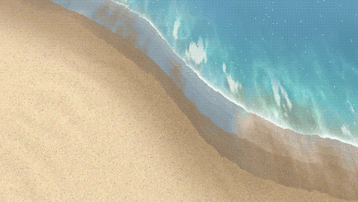

*The shore loop (40 seconds, shown here at 5× speed).*

### Day styles

| | | |
|---|---|---|
| 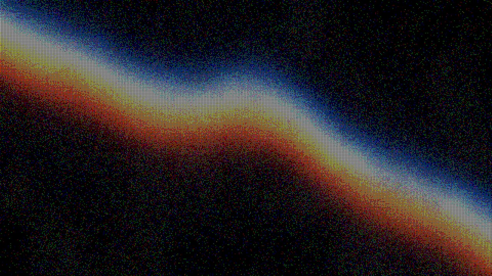 **Spectrum** |  **Halftone** |  **Blue sky** |
| 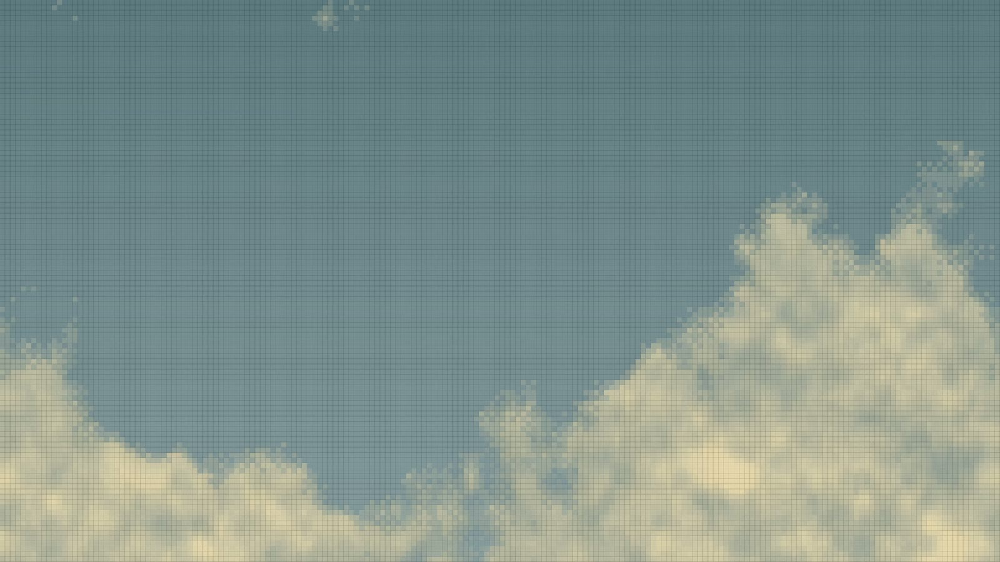 **Pixel clouds** | 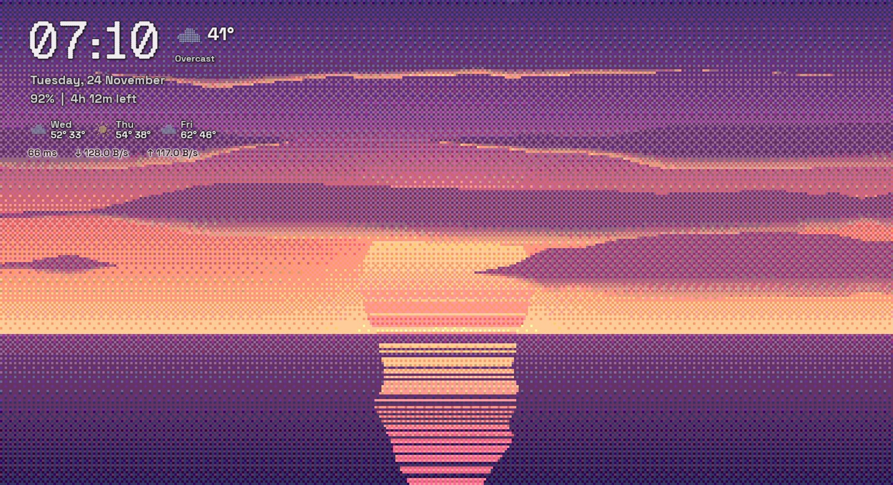 **Sunset strata** |  **Riso waves** |
| 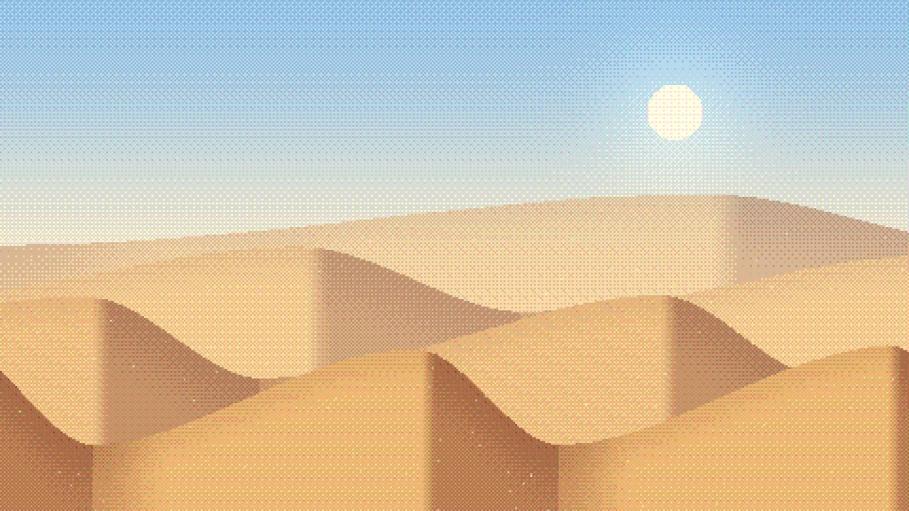 **Dunes** | 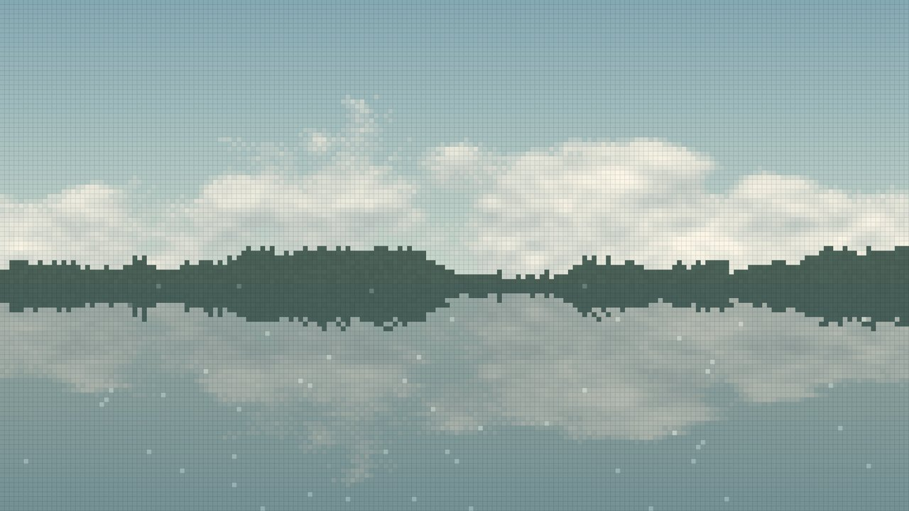 **Lake** | 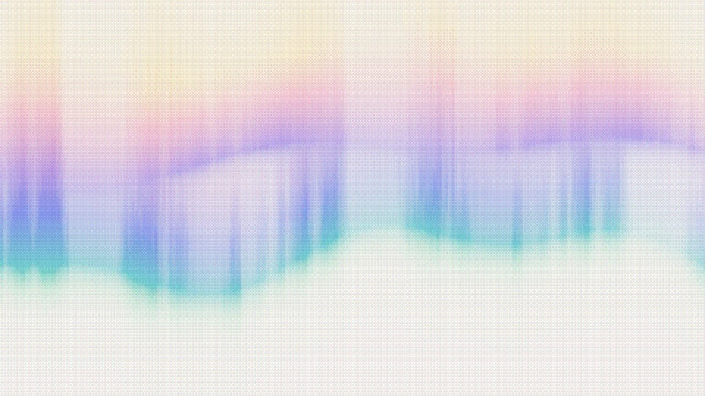 **Pastel aurora** |
| 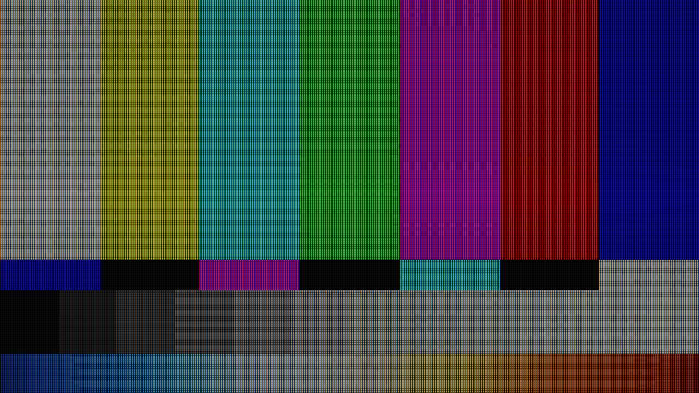 **CRT test card** |  **Shore** |  |

Gradient is also a day style.

### Night styles

Dark styles rotate in at night.

| | | |
|---|---|---|
| 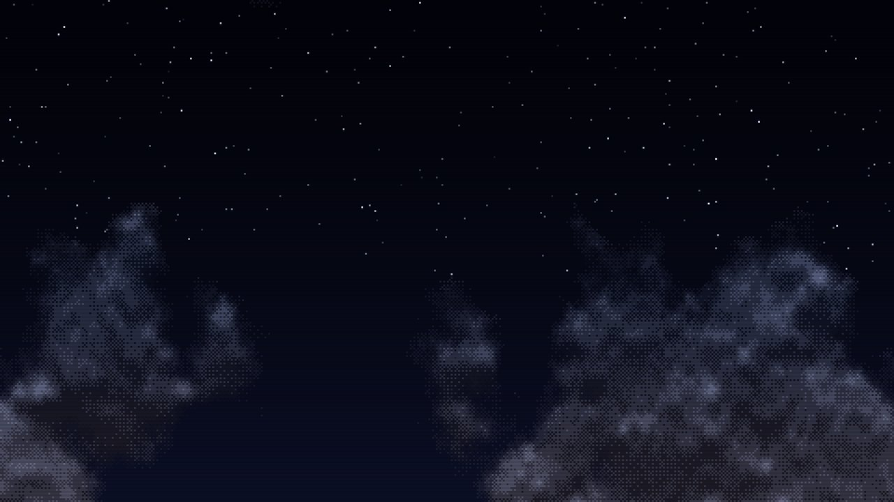 **Night clouds** | 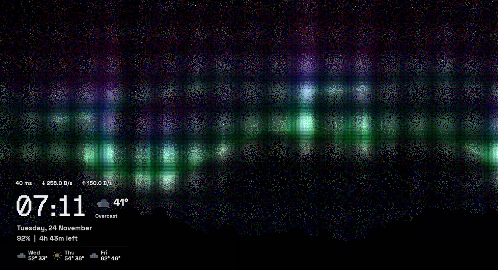 **Aurora** |  **Nebula** |
|  **Halftone moon** | 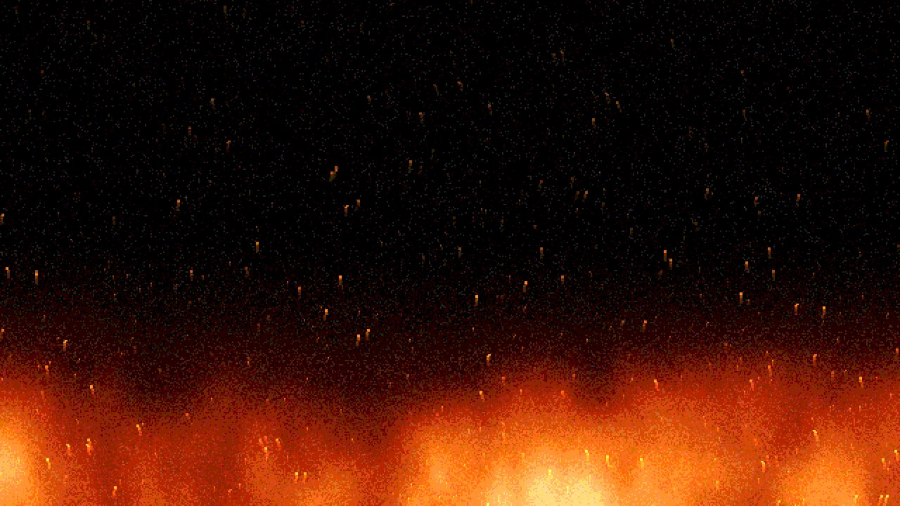 **Embers** | 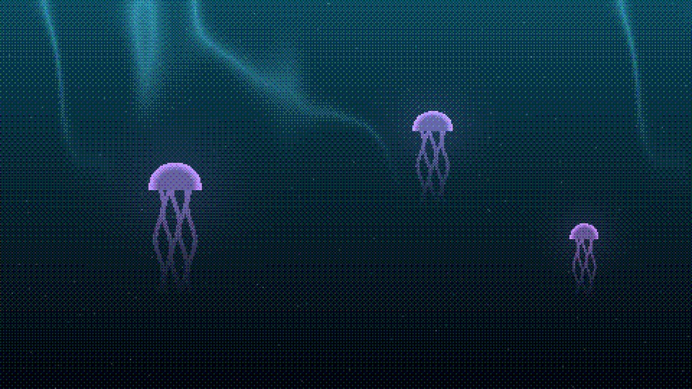 **Deep sea** |
| 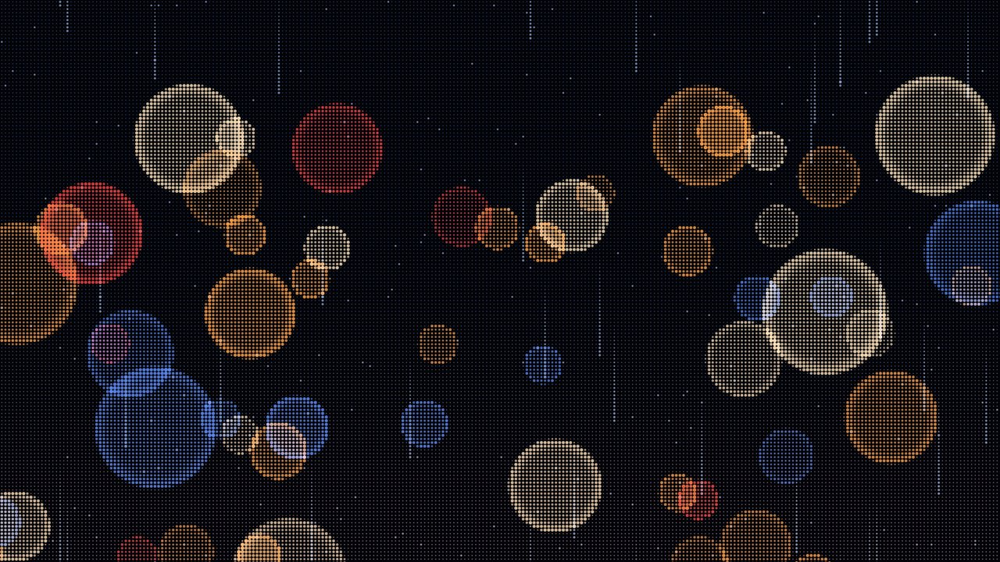 **Rainy window** |  |  |

Bouncing logo is also a night style.

## Widgets

All widgets live in `Documents\Rainmeter\Skins\Loopscape`. Clock, Network and Now Showing start visible; the others start hidden. Show or hide any of them from the tiles in **Settings → Widgets**.

| Widget | What it shows |
|---|---|
| **Clock** | The time and date, the current weather and a three-day forecast. On laptops and tablets it also shows the battery level and time left; on desktops the battery line is hidden. |
| **Network** | On Wi‑Fi, the network name and signal, band, channel, link speed and security. On Ethernet, the adapter, link speed, gateway, DNS server and MAC address. Both show the local IP address, live ping and download and upload speed. |
| **Now Showing** | The wallpaper style on screen and when rotation will change it, with buttons to go back, pause, skip ahead or keep the current style. |
| **Sun & Moon** | The sun's path across today's sky, the next sunrise or sunset, and the moon's phase. |
| **Rain** | Rain or snow in the next 3 hours in 15-minute steps, such as "Rain in ~20 min". |
| **System** | Processor and memory use, and free space on drive C:. |
| **Calendar** | This month with today circled. Scroll over it to see other months. The week starts on the day set in Windows. |

**Placement.** Each wallpaper style suggests a calm spot for the widgets, and they move there when the style changes (Settings → Rotation → *Move widgets with wallpaper*). Drag a widget and it snaps to screen spots and to the other widgets; stacked widgets share one width. Settings → Widgets has switches for snapping, matching widths, and the height of the bottom snap spots (above the taskbar, over it, at the screen edge, or any number of pixels). It also sets the clock's date format.

**Views.** Middle-click a widget, or right-click it, to pick a view. The Clock, for example, has Full, Simple, Compact and Time only, and Network has Full, Simple and Speeds.

**Readability.** Settings → Look controls how the text stands out from the wallpaper. *Panel darkness* puts a dark box behind each widget. With the panel off, the text can sit on pills and turn light or dark to suit the wallpaper. *Text boost* adds anything from a soft shadow to a bold outline.

**Size.** Settings → Look → *Widget size* makes the widgets bigger. On *Auto* they grow with the screen: 100% up to 1080p, 125% at 1440p, 200% at 4K. You can also pick a fixed size from 100% to 250%.

**Profiles.** Settings → Profiles saves everything in the panel, plus each widget's view, to one of three slots. Load a slot to switch back to that setup.

## Using Loopscape

Click the Loopscape tray icon to open the widgets' Settings panel, or right-click it for the menu.

### Pick and rotate styles

- **Pick a style:** Settings → Wallpaper, or the tray menu's *Change wallpaper*. Right-click a style in Settings to leave it out of rotation.
- **Rotate day/night:** changes style every hour by default (Settings → Rotation → *Change every*). Night styles take over at a set time or from sunset to sunrise, With *Match the weather* on, rain brings Rainy window, a clear night brings Halftone moon, and overcast or foggy skies bring clouds.
- **Skip to the next style:** Win+Alt+N, the Now Showing widget, or a widget's right-click menu.

### Battery and performance

- **On battery:** Settings → Rotation → *On battery* pauses the animation by default. You can keep it playing or switch to a still image.
- **Pause when covered:** the animation pauses while a maximized or fullscreen window covers the desktop.
- **Always animate:** a checkbox in the tray menu that keeps the wallpaper moving on battery and behind maximized or fullscreen windows. It overrides *On battery* and *Pause when covered*, and uses more battery. *Pause animation* still works.
- **Video format:** the tray menu's *Video format*. *Automatic* picks the smallest format your graphics chip plays (AV1, then HEVC, then H.264), so the processor stays idle. On a desktop where battery doesn't matter you can pick AV1 for smaller files even if the processor has to decode it. Changing it downloads your styles again in that format. Styles that don't look as good in a format are only published in H.264.
- **Big screens:** the styles are 1080p videos scaled up to fit your screen. On 4K screens the square-pixel styles use sharp 2× scaling, so they look as crisp as on a 1080p screen (`sharpScaling` in Loopscape.ini).

### Other settings

- **Weather location:** Settings → Widgets → *Weather location*. Type a city, or use Windows location.
- **Clock format and temperature unit:** Settings → Widgets.
- **Start with Windows:** a checkbox in the tray menu (also in Task Manager → Startup apps).
- **Advanced settings:** `%USERPROFILE%\Loopscape\Loopscape.ini`. It's commented, and changes apply on their own.

### Update Loopscape

*Update Loopscape* is in the tray menu and in Settings → Look.

- If you installed with the setup program, it opens the [newest release](https://github.com/choco-mazapan/loopscape/releases/latest) so you can download its installer.
- If you run Loopscape from a git clone of this repository (see [Building from source](#building-from-source)), it opens a window that lists the new changes to Loopscape and its widgets, with this PC's version and the new one. **Update** turns on once GitHub reports that the new version passed its build checks, which takes a few minutes after a change. Press it to get them: a progress bar follows the rebuild, and the window then shows what was updated. Changes only to files Loopscape doesn't use, such as this README, the screenshots or the installer, aren't listed and don't count as an update.

  After it has checked once, the tray menu and Settings → Look show the result: *Loopscape is up to date* with this PC's version, or how many new changes are waiting. The result is from the last time you chose *Update Loopscape*; Loopscape doesn't check by itself.

## Make your own style with Claude

[`skills/loopscape-style`](skills/loopscape-style) is a [Claude skill](https://docs.claude.com/en/docs/agents-and-tools/agent-skills/overview) that turns your own photo or video into a Loopscape style: LED dots, halftone, dither, duotone or pixel art, as a 1920×1080 video that loops without a jump. Ask Claude something like *"make this photo into a Loopscape wallpaper"*. It shows you a few looks, then makes the video and adds it to the tray menu's *Change wallpaper*. I recommend a landscape picture that isn't too detailed, will make for a better loop.

- **Claude Code** (or the Code tab of the Claude desktop app): copy the `skills\loopscape-style` folder to `%USERPROFILE%\.claude\skills\`. Claude installs what it needs (Python's Pillow and NumPy, and FFmpeg) if they're missing.
- **Claude.ai**: zip the folder and add it under Settings → Capabilities → Skills. It runs in the cloud, so Claude gives you the video and a still image to put in `%USERPROFILE%\Loopscape\styles` yourself.

Your own styles aren't part of *Rotate day/night*; pick them from the tray menu. The dot effects come from [dotfx](https://github.com/thibaud360/dotfx) by Thibaud Francony (MIT license), included in the skill.

## Privacy and what it changes on your PC

Loopscape needs no administrator rights, runs no scripts, and doesn't change your Windows wallpaper settings. It connects to:

- [Open-Meteo](https://open-meteo.com/) for the weather and to look up your city (no account, no API key).
- [BigDataCloud](https://www.bigdatacloud.com/), only if you choose *Windows location*, to name the place.
- GitHub, to download styles you pick, and when you choose *Update Loopscape*.

There's no IP-address location lookup, telemetry or automatic update check. Loopscape only looks for a new version when you choose *Update Loopscape*.

| What | Where | Removed by uninstall |
|---|---|---|
| The program (Loopscape, mpv video player, list of downloadable styles) | `%LOCALAPPDATA%\Programs\Loopscape` | Yes |
| Videos, stills, Loopscape.ini, log | `%USERPROFILE%\Loopscape` | If you choose to |
| Status files Loopscape and the widgets share while they run, weather cache | `%LOCALAPPDATA%\Loopscape` | Yes |
| The widgets | `Documents\Rainmeter\Skins\Loopscape` | Yes (your widget settings only if you choose to) |
| Start with Windows | `HKCU\Software\Microsoft\Windows\CurrentVersion\Run` → `Loopscape` | Yes |
| Apps list entry | Settings → Apps → Installed apps | Yes |
| Rainmeter (optional) | Installed by its official installer | No, uninstall it separately |

To uninstall, go to Settings → Apps → Loopscape → Uninstall. It asks whether to also delete your videos and settings.

## Building from source

This section is for developers. You don't need any of it to use Loopscape.

### Repository layout

| Path | Contents |
|---|---|
| `wallpaper/` | The Loopscape launcher (`Loopscape/`, one C# file per part: `Program.cs` holds the main loop) and the video and still renderers (`make-loop.ps1`, `styles/`). |
| `rainmeter/Loopscape/` | The Rainmeter skin: Clock, WiFi (the Network widget), NowShowing, SunMoon, Rain, System, Calendar, Settings, ViewMenu and SnapGuides, with shared code in `@Resources` (`snap.lua` handles placement and snapping). Versions before 1.1 installed it as `Skins\LaptopInfo`; the installer moves it. |
| `rainmeter/WeatherFetch.cs`, `rainmeter/WifiInfo.cs` | Helpers the skin calls. |
| `rainmeter/gen-settings-ini.ps1` | Generates `Settings/Settings.ini`. Edit the script, not the generated file. |
| `build/` | `build.ps1` compiles everything with the C# compiler built into Windows (.NET Framework 4.x). `stage.ps1` and `make-styles-release.ps1` prepare a release. |
| `installer/` | The [Inno Setup](https://jrsoftware.org/isinfo.php) script (`Loopscape.iss`) and the list of downloadable styles with their checksums. |
| `skills/loopscape-style/` | The Claude skill for making your own styles (`make_style.py`, with dotfx's `dotfx.py`). |
| `sync.ps1` | Pushes your working copy to the running setup: it rebuilds what changed, copies the skin and restarts Loopscape. It also saves the clone's folder as `sourceFolder` in Loopscape.ini. |
| `update.ps1` | What *Update Loopscape* runs when `sourceFolder` is set. See below. |

### Run from a clone

Clone the repository and run `.\sync.ps1`. After that, *Update Loopscape* runs `update.ps1`, which fetches `origin/main`, lists the new commits and asks the GitHub API whether the jobs in `.github/workflows/check.yml` passed on that exact commit. It installs nothing that failed or wasn't checked, and it refuses an `origin` that isn't on GitHub unless you run `update.ps1 -SkipCheck`. After you press **Update**, it fast-forwards the clone to the checked commit, runs `sync.ps1 -Progress` and shows the result (details in `%USERPROFILE%\Loopscape\update.log`). It saves what it found in `%LOCALAPPDATA%\Loopscape\updatestatus.txt` for the tray menu and the Settings panel; `sync.ps1` deletes that file when it installs a different commit, so a manual `git pull` and sync never leave a stale *up to date*. If the clone has local changes or is on another branch, the window says so, and Update sets them aside with `git stash` and switches to `main`. Run `git stash pop` to bring the changes back.

Versions are the last `v` tag plus the number of commits since it (`v1.0.0` plus 45 commits is 1.0.0.45). `update.ps1 -DryRun` changes nothing.

### Checks

Every pull request and every push to `main` runs the [check workflow](.github/workflows/check.yml). It compiles the programs with `build\build.ps1`, parses every PowerShell script, confirms `Settings.ini` matches what `gen-settings-ini.ps1` generates, and parses every Lua script (with Lua 5.1, the version Rainmeter runs) and every Python script in the skill.

### Render the videos

Rendering needs [FFmpeg](https://ffmpeg.org/) with libx265, libsvtav1 and libvmaf (`winget install Gyan.FFmpeg`, the full build). The loop goes to `%USERPROFILE%\Loopscape`; each style is rendered once and encoded as H.264, HEVC and AV1 into `build\videos`:

```powershell
.\wallpaper\make-loop.ps1
.\wallpaper\styles\build-styles.ps1
```

HEVC and AV1 files are kept only if they're at least 15% smaller than H.264 and score within 1 VMAF point of it against a lossless render (`-MinSaving`, `-MaxVmafLoss`; results in `build\videos\quality.txt`). A full render takes about 2 hours of CPU time. `build-styles.ps1 -Styles riso,shore` renders only some styles, and `-Preview` renders one still per style. `wallpaper\styles\make-stills.ps1` renders PNG stills to use as a normal Windows background.

### Make a release

If the styles changed (new or re-rendered videos or stills):

1. Run `build\make-styles-release.ps1 -Tag styles-v<n>` with a new tag.
2. Make a `styles-v<n>` release from `build\styles-release` with **Set as the latest release** turned off (`gh release create styles-v<n> build\styles-release\* --latest=false`), so the README's download link keeps pointing at the installer.
3. Commit `installer\styles.json` and `installer\styles-SHA256SUMS.txt`.

Then push a `v*` tag on `main`, such as `git tag v1.1.0 && git push origin v1.1.0`. The [release workflow](.github/workflows/release.yml) builds the installer and makes a draft release with it, `SHA256SUMS.txt` and notes listing the pull requests since the previous `v*` release. Look it over and publish it; it then becomes the latest release.

## License

[MIT](LICENSE). The bundled fonts, Space Grotesk and Geist Pixel, keep their own licenses (see `rainmeter/Loopscape/@Resources/Fonts`). Third-party components are listed in [THIRD-PARTY-NOTICES.txt](THIRD-PARTY-NOTICES.txt).
