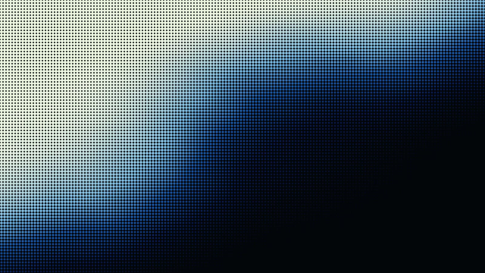

# Loopscape

**Loopscape** is a live wallpaper for Windows 10 and 11. It plays looping animated landscapes (shores, pixel clouds, auroras, nebulas and more) behind your desktop icons, with dark styles at night. It comes with desktop widgets for Rainmeter: a clock with battery and weather, Wi‑Fi and network details, a Now Showing card for the wallpaper itself, and optional Sun & Moon, Rain, System and Calendar widgets. They live in `Documents\Rainmeter\Skins\Loopscape`.


## Screenshots

Each style is a looping video; the widgets snap to a spot that suits it.


*The shore loop (40 s, shown here at 5× speed).*


| | | |
|---|---|---|
|  **pixelclouds** |  **shore** |  **sunset** |
|  **bluesky** |  **halftone** |  **aurora** |
|  **nebula** |  **moon** |  **riso** |

Dark styles (aurora, nebula, moon, …) rotate in at night.

## Install

Works on Windows 10 and 11 (64-bit).

1. Download `Loopscape-Setup-<version>.exe` from [Releases](https://github.com/choco-mazapan/loopscape/releases).
2. Run it. It installs for your user only, so there's no administrator prompt (except Rainmeter's own installer, if you tick it).
3. Type your city for the weather, and leave **Install Rainmeter** ticked if you don't have it. Rainmeter is the free, open-source program that draws the widgets.

The installer isn't code-signed yet, so Windows SmartScreen may say "Windows protected your PC". Click **More info → Run anyway**. `SHA256SUMS.txt` on the release page has the installer's checksum, and the [release workflow](.github/workflows/release.yml) log shows it was built from the tagged source.

Four styles come with the installer (riso, shore, pixel clouds, aurora). On the **Wallpaper styles** page, choose whether to download the other 15 after setup (about 250 MB): all of them, none, or the ones you tick. They download in the background, about 2–50 MB each depending on the video format. Any you skip download the first time you pick them, or all at once from the tray icon's menu.

## Usage

- **Pick a style:** click the tray icon for the widgets' Settings panel, or right-click it for the style menu.
- **Rotate styles:** choose *Rotate day/night* in the Settings panel. It changes style every hour by default (*Change every* in the Rotation section), with dark styles at night.
- **Skip to the next style:** Win+Alt+N.
- **Now Showing widget:** shows the style on screen and when the rotation changes it, with buttons to go back, pause the animation, skip ahead or keep the current style. Hide it in Settings → Widgets.
- **More widgets:** Settings → Widgets has a tile for each widget; click one to show or hide it. The extra ones start hidden:
  - **Sun & Moon:** the sun's path across today's sky, the next sunrise or sunset, and the moon's phase.
  - **Rain:** rain or snow in the next 3 hours, in 15-minute steps ("Rain in ~20 min").
  - **System:** processor and memory use, and free space on drive C:.
  - **Calendar:** this month with today ringed; scroll over it for other months. The week starts on the day set in Windows.
- **Views:** middle-click a widget to switch between its full and simple views.
- **Always animate:** a checkbox in the tray menu that keeps the wallpaper moving on battery and behind maximized or fullscreen windows. It overrides Settings → Rotation → *On battery* and *Pause when covered*, and uses more battery. *Pause animation* still works.
- **Start with Windows:** a checkbox in the tray menu (also in Task Manager → Startup apps).
- **Video format:** the tray menu's *Video format*. *Automatic* picks the smallest format your graphics chip plays (AV1, then HEVC, then H.264), so the CPU stays idle. On a desktop where battery doesn't matter you can pick AV1 for smaller files even if the CPU has to decode it. Changing it downloads your styles again in that format. Styles that don't look as good in a format are only published in H.264.
- **Big screens:** the styles are 1080p videos scaled up to fit your screen. On 4K screens the square-pixel styles use sharp 2× scaling, so they look as crisp as on a 1080p screen (`sharpScaling` in Loopscape.ini).
- **Weather location:** Settings panel → Widgets → City.
- **Advanced settings:** `%USERPROFILE%\Loopscape\Loopscape.ini` (commented; changes apply by themselves).

## Make your own style with Claude

[`skills/loopscape-style`](skills/loopscape-style) is a [Claude skill](https://docs.claude.com/en/docs/agents-and-tools/agent-skills/overview) that turns your own photo or video into a Loopscape style: LED dots, halftone, dither, duotone or pixel art, as a 1920×1080 video that loops without a jump. Ask Claude something like *"make this photo into a Loopscape wallpaper"*. It shows you a few looks, then makes the video and adds it to Loopscape's tray menu (right-click → *Change wallpaper*).

- **Claude Code** (or the Code tab of the Claude desktop app): copy the `skills\loopscape-style` folder to `%USERPROFILE%\.claude\skills\`. Claude installs what it needs (Python's Pillow and NumPy, and FFmpeg) if they're missing.
- **Claude.ai**: zip the folder and add it under Settings → Capabilities → Skills. It runs in the cloud, so Claude hands you the video and a picture of it to put in `%USERPROFILE%\Loopscape\styles` yourself.

Your own styles aren't part of *Rotate day/night*; pick them from the tray menu. The dot effects come from [dotfx](https://github.com/thibaud360/dotfx) by Thibaud Francony (MIT license), included in the skill.

## What it changes on your PC

| What | Where | Removed by uninstall |
|---|---|---|
| The program (Loopscape, mpv video player, list of downloadable styles) | `%LOCALAPPDATA%\Programs\Loopscape` | yes |
| Videos, stills, Loopscape.ini, log | `%USERPROFILE%\Loopscape` | if you choose to |
| The widgets | `Documents\Rainmeter\Skins\Loopscape` | yes (your settings only if you choose to) |
| Start with Windows | `HKCU\Software\Microsoft\Windows\CurrentVersion\Run` → `Loopscape` | yes |
| Apps list entry | Settings → Apps → Installed apps | yes |
| Rainmeter (optional) | installed by its official installer | no: uninstall it separately |

It needs no administrator rights, runs no scripts, and doesn't change your Windows wallpaper settings. It connects to:

- [Open-Meteo](https://open-meteo.com/) for the weather and to look up your city (no account, no API key).
- [BigDataCloud](https://www.bigdatacloud.com/), only if you choose *Windows location*, to name the place.
- GitHub, to download styles you pick.

There's no IP-address location lookup, telemetry or update check.

To uninstall, use Settings → Apps → Loopscape → Uninstall. It asks whether to also delete your videos and settings.

## Building from source

Developer setup. Users don't need any of this.

- `wallpaper/` holds the Loopscape launcher (`Loopscape.cs`) and the video and still renderers (`make-loop.ps1`, `styles/`).
- `rainmeter/Loopscape/` is the Rainmeter skin (Clock, WiFi, NowShowing, SunMoon, Rain, System, Calendar, Settings, ViewMenu, SnapGuides). Versions before 1.1 installed it as `Skins\LaptopInfo`; the installer moves it.
- `rainmeter/WeatherFetch.cs` and `rainmeter/WifiInfo.cs` are the helpers the skin calls.
- `build/build.ps1` compiles everything with the C# compiler built into Windows (.NET Framework 4.x).
- `build/stage.ps1` and `installer/Loopscape.iss` ([Inno Setup](https://jrsoftware.org/isinfo.php)) build the installer.
- `skills/loopscape-style/` is the Claude skill for making your own styles (`make_style.py`, with dotfx's `dotfx.py`).
- `sync.ps1` pushes your working copy to the running setup: it rebuilds what changed, copies the skin and restarts Loopscape.

Rendering the videos needs [FFmpeg](https://ffmpeg.org/) with libx265, libsvtav1 and libvmaf (`winget install Gyan.FFmpeg`, the full build). The loop goes to `%USERPROFILE%\Loopscape`; each style is rendered once and encoded as H.264, HEVC and AV1 into `build\videos`:

```powershell
.\wallpaper\make-loop.ps1
.\wallpaper\styles\build-styles.ps1
```

HEVC and AV1 files are kept only if they're at least 15% smaller than H.264 and score within 1 VMAF point of it against a lossless render (`-MinSaving`, `-MaxVmafLoss`; results in `build\videos\quality.txt`). A full render takes about 2 hours of CPU. `build-styles.ps1 -Styles riso,shore` renders only some styles, and `-Preview` renders one still per style. `wallpaper\styles\make-stills.ps1` renders PNG stills for use as a normal Windows background.

To make a release:

1. Run `build\make-styles-release.ps1`.
2. Upload `build\styles-release` to the `styles-v1` release.
3. Commit `installer\styles.json` and `installer\styles-SHA256SUMS.txt`.
4. Push a `v*` tag. The [release workflow](.github/workflows/release.yml) builds the installer and makes a draft release.

Fonts: Space Grotesk and Geist Pixel, bundled under their own licenses (see `rainmeter/Loopscape/@Resources/Fonts`).

## License

[MIT](LICENSE). The bundled fonts keep their own licenses.
